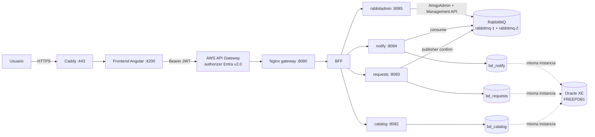
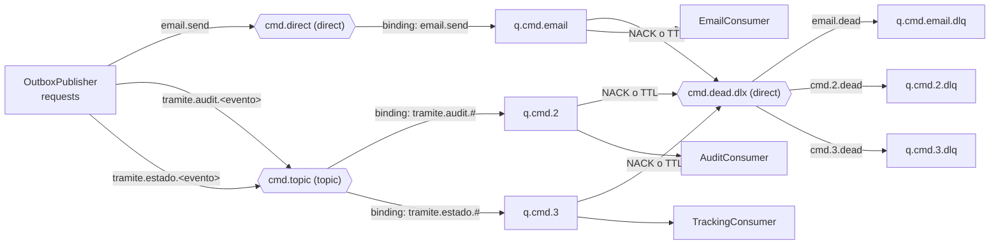
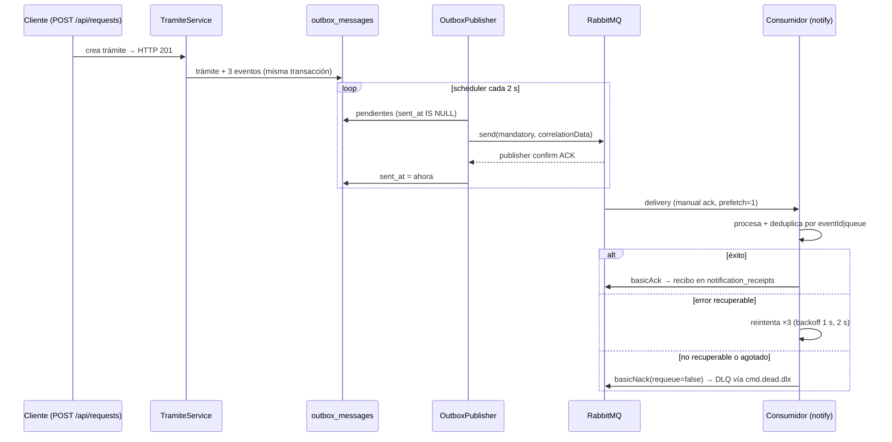

# BarrioDigital EP2 con Docker

Proyecto basado en el Angular/MSAL y Spring Boot entregados, integrado con BFF, catálogo, trámites, consumidor de notificaciones, RabbitAdmin y clúster RabbitMQ de dos nodos. Se conservan las pantallas y las reglas de transición de trámites. Todas las operaciones de la interfaz ahora esperan y guardan en la API.

**Oracle queda pendiente para la siguiente etapa.** El arranque utiliza H2 en archivos persistentes dentro de volúmenes Docker separados. El correo es una simulación persistida por `notify`; no se envían correos reales.

## Inicio rápido en Windows

Requisitos: Docker Desktop iniciado, modo contenedores Linux y Docker Compose v2. No necesitas instalar Java, Maven ni Node para usar Docker. Reserva aproximadamente 6 GB de memoria para el conjunto y espacio para las imágenes. La primera compilación descarga dependencias y puede tardar varios minutos.

Extrae el ZIP, abre PowerShell **dentro de esta carpeta** y ejecuta:

```powershell
Copy-Item .env.example .env
docker compose -f compose.yml -f compose.demo.yml up -d --build
docker compose ps
```

Espera a que los servicios queden `healthy`. `cluster-check` debe terminar con código 0; es una comprobación puntual y no permanece encendido. Abre **http://localhost:4200** y selecciona una cuenta de prueba. El modo demo no llama a Microsoft y sirve únicamente para el laboratorio local.

También puedes usar `./scripts/start.ps1 -Mode demo`, que prepara `.env`, valida Compose y espera el arranque. En Linux/macOS: `sh scripts/start.sh demo`.

## Usar tu inicio de sesión de Microsoft

Se conservaron los identificadores públicos de Entra ID presentes en tu proyecto. Verifica las asignaciones del tenant siguiendo [ENTRA_Y_AWS.md](docs/ENTRA_Y_AWS.md). Luego ejecuta:

```powershell
docker compose up -d --build
```

El archivo principal establece `AUTH_MODE=entra` para todos los servicios. Ejecutar el archivo principal después del demo recrea los contenedores con la autenticación real. Ingresar con Microsoft requiere roles en el **access token de la API**, no solo en el ID token del frontend.

## URLs y credenciales del laboratorio

| Servicio | URL desde tu equipo | Acceso |
| --- | --- | --- |
| Angular | http://localhost:4200 | Entra ID o cuentas demo, según arranque |
| API de entrada | http://localhost:8080/api/public | Comprobación pública del BFF |
| RabbitMQ nodo 1 | http://localhost:15672 | `barriodigital` / valor de `RABBITMQ_PASSWORD` |
| RabbitMQ nodo 2 | http://localhost:15673 | Mismas credenciales |

La contraseña de ejemplo es `barriodigital-local`. Los puertos publicados se limitan a `127.0.0.1`. BFF y microservicios se comunican por la red Docker; no tienen puertos directos publicados. Los puertos AMQP son 5672 y 5673 desde el host, pero **ambos nodos usan 5672 dentro de Docker**.

## Organización

| Carpeta | Contenido |
| --- | --- |
| `frontend` | Angular 22, MSAL, formularios conectados y Dockerfile con Nginx |
| `backend/bff` | Entrada Spring Boot, validación JWT y reenvío de Bearer/correlación |
| `backend/catalog` | Catálogo y cupos por tipo |
| `backend/requests` | Trámites, estados, control de propietario y outbox transaccional |
| `backend/notify` | Tres consumidores, reintentos, ACK/NACK y bandeja de eventos procesados |
| `backend/rabbitadmin` | REST de administración y métricas de RabbitMQ |
| `backend/common` | Seguridad, contrato de mensajes y topología compartida |
| `infra` | Gateway local Nginx y configuración del clúster |
| `postman` | Colección y entorno para las demostraciones |
| `scripts` | Arranque y prueba integral HTTP |
| `docs` | Arquitectura, pruebas, configuración Entra/AWS y preparación Oracle |

Los cinco servicios Java se construyen desde un Dockerfile con cinco etapas finales (`target`). La etapa de compilación Maven es compartida por la caché de Docker. Se mantienen Spring Boot 4.1.1 y Java 21 del proyecto original.

## Prueba empírica

Sigue [PRUEBA_EP2.md](docs/PRUEBA_EP2.md). Está preparado lo siguiente:

1. Crear un trámite con correo válido: publicación en `cmd.direct`, clave `email.send`, consumo en `q.cmd.email` y ACK.
2. Crear otro con **`error@barriodigital.test`**: tres intentos, backoff de 1 y 2 segundos, NACK sin requeue y llegada a `q.cmd.email.dlq`.
3. Crear `q.test.barriodigital` por RabbitAdmin y repetir con nombre vacío: HTTP 201 y HTTP 400, respectivamente.

`DEMO_FAILURE_ENABLED=true` habilita el dato de error para el laboratorio, incluso si autenticas con Entra. Desactívalo para un entorno real.

## Comandos habituales

```powershell
docker compose logs -f requests notify
docker compose exec rabbitmq-1 rabbitmqctl cluster_status
docker compose exec rabbitmq-2 rabbitmqctl cluster_status
docker compose stop
docker compose start
```

`docker compose down` quita contenedores y red, pero conserva los volúmenes. **`docker compose down -v` borra los datos de H2 y RabbitMQ**; úsalo solamente si quieres reiniciar completamente el laboratorio.

Para reconstruir un cambio, usa `docker compose up -d --build` y agrega `-f compose.yml -f compose.demo.yml` si estás trabajando en demo. Evita arrancar otro proyecto RabbitMQ sobre 5672/15672 al mismo tiempo.

## Verificación

Consulta [VALIDACION.md](docs/VALIDACION.md) para conocer qué comprobaciones se ejecutaron y cuáles requieren Docker en tu equipo. Compilación y pruebas manuales de desarrollo:

```powershell
cd backend
.\mvnw.cmd verify
cd ..\frontend
npm ci
npm test -- --watch=false
npm run build
```

Las pruebas de Maven usan H2 y dobles de RabbitMQ; no requieren un broker. La prueba integral `python scripts/smoke.py --mode demo` sí requiere todo el Compose iniciado.

## Alcances técnicos

- Las colas son clásicas y durables, conforme a las guías. Dos nodos permiten reconectar, pero **no replican estas colas**. Si cae el nodo propietario, su cola puede quedar temporalmente indisponible. Ver [ARQUITECTURA.md](docs/ARQUITECTURA.md).
- Un HTTP 201 confirma trámite y outbox guardados. El scheduler publica después y solo marca cada evento como enviado al recibir confirmación del broker sin devolución de ruta. No significa que el consumidor ya terminó.
- La entrega es al menos una vez: el consumidor registra y deduplica por evento y cola. El dispatcher se entrega para una réplica de `requests`; antes de escalarlo hay que incorporar reclamos/leases de filas en outbox.
- La eliminación del catálogo es una desactivación para conservar el historial de trámites. Los trámites solo se editan o eliminan en `INGRESADO`.
- La migración de datos H2 antiguos no se ejecuta: este proyecto comienza con un catálogo semilla y sin trámites ficticios.
- El gateway Docker es un proxy local. No configura ni despliega recursos en tu cuenta AWS. BFF y servicios validan JWT; el authorizer del AWS HTTP API se configura en la etapa de despliegue.

## Referencia de arquitectura y mensajería

Material de apoyo para entender y defender el diseño. Describe lo que
existe en el código y dónde encontrarlo — la explicación de cada
concepto corre por cuenta del presentador.

### Arquitectura general



### Topología de mensajería

Definida en `backend/common/.../MessagingConfig.java` (beans por caso
de uso) con nombres centralizados en `MessagingNames.java`.



| Elemento | Valor |
|---|---|
| Colas principales | `q.cmd.email`, `q.cmd.2`, `q.cmd.3` — clásicas, durables, TTL 30 s |
| DLQ | `*.dlq` — durables, TTL 7 días, maxLength 10.000 |
| Exchanges | `cmd.direct` (clave exacta), `cmd.topic` (patrón `#`), `cmd.dead.dlx` |
| Dead-letter | argumentos `x-dead-letter-exchange` + `x-dead-letter-routing-key` por cola |

### Recorrido de un mensaje



Archivos: productor `requests/.../OutboxWriter.java` +
`OutboxPublisher.java`; consumidores `notify/.../consumer/*.java` con
lógica compartida en `CommandMessageHandler.java` (ACK/NACK manual,
reintentos, decisión recuperable vs no recuperable).

### Infraestructura

- Dos nodos `rabbitmq-1`/`rabbitmq-2` en clúster por
  `RABBITMQ_ERLANG_COOKIE` compartida; verificación puntual con el
  servicio `cluster-check` y `rabbitmqctl cluster_status`.
- Las colas son **clásicas**: el clúster permite reconexión entre
  nodos, no replicación de colas (sin quorum queues). Si cae el nodo
  propietario de una cola, queda indisponible hasta su retorno; los
  eventos no confirmados permanecen en el outbox.
- Compose local (`compose.yml`), publicación cloud
  (`compose.cloud.yml`), base de datos (`compose.oracle.yml`) y demo
  (`compose.demo.yml`) son overrides separados.

### Administración implementada

`rabbitadmin` (`/api/rabbitmq/*`, rol ADMIN): `POST/DELETE /queues`,
`POST/DELETE /exchanges`, `POST/DELETE /bindings`,
`POST /queues/{name}/purge?confirm=true` y consultas de monitoreo
`GET /queues|consumers|nodes|overview` vía Management HTTP API.
La lógica AMQP vive en `RabbitAdminService`; la validación restringe
los nombres al espacio `q.test.*` / `x.test.*` con DTOs anotados.

### Métricas, logs y control de crecimiento

- Management UI (`:15672`, `:15673`): mensajes Ready/Unacked,
  consumidores por cola, contadores de DLQ, `x-death` en cabeceras.
- Cada nodo expone Prometheus en `:15692` (listener activo; el stack
  no incluye un servidor Prometheus recolectándolo).
- Logs por evento: `Publicando`, `Confirmación de publicación ACK`,
  `Mensaje recibido`, `Procesamiento exitoso`, `ACK enviado`,
  `NACK enviado requeue=false` — trazables por `eventId` y
  `correlationId`.
- Control de crecimiento: TTL 30 s en colas principales (expiran a la
  DLQ con motivo `expired`), TTL 7 días + `x-max-length` 10.000 en DLQ,
  y el job `OutboxPublisher.retention()` borra publicaciones enviadas
  con más de 7 días cada hora.

### Lo que NO está implementado

Quórum/mirror queues, federación o shovel, vhosts adicionales,
políticas `x-policy` a nivel de broker (los límites son argumentos por
cola), scraping de Prometheus, envío real de correo (se persiste como
`EMAIL_SIMULADO`) y réplicas del dispatcher de outbox.
