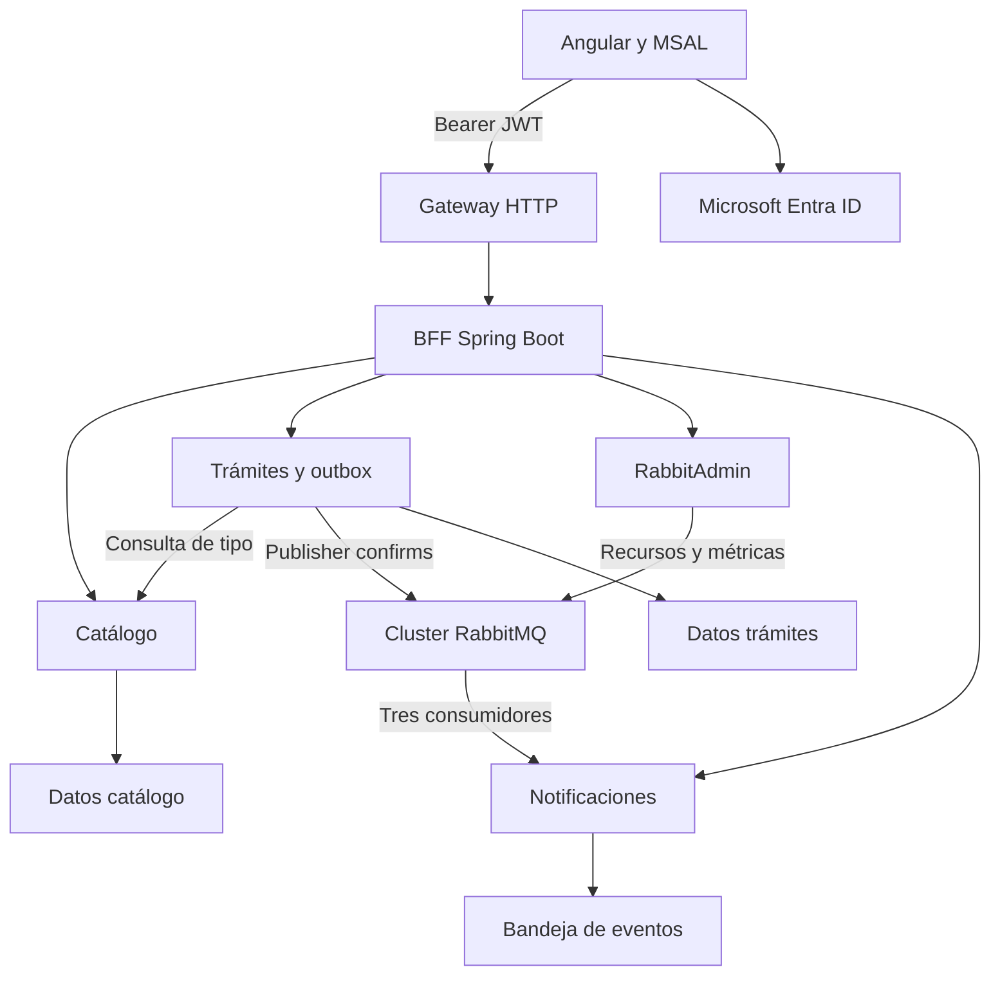

# Arquitectura implementada

En Docker, `Gateway HTTP` corresponde a Nginx. En AWS corresponde al API Gateway del diseño del curso, con su authorizer JWT. Entra ID sigue siendo un servicio externo. Las bases son H2 persistentes hasta configurar Oracle.

## Topología RabbitMQ

| Exchange | Tipo | Routing key / patrón | Cola | DLQ | Clave en `cmd.dead.dlx` |
| --- | --- | --- | --- | --- | --- |
| `cmd.direct` | direct | `email.send` | `q.cmd.email` | `q.cmd.email.dlq` | `email.dead` |
| `cmd.topic` | topic | `tramite.audit.#` | `q.cmd.2` | `q.cmd.2.dlq` | `cmd.2.dead` |
| `cmd.topic` | topic | `tramite.estado.#` | `q.cmd.3` | `q.cmd.3.dlq` | `cmd.3.dead` |

`cmd.dead.dlx` es direct y durable. Todas las colas son classic, durables, no exclusivas y sin auto-delete. Las principales tienen TTL 30.000 ms. Las DLQ retienen hasta 7 días y 10.000 mensajes por cola; al exceder la capacidad se descartan mensajes más antiguos según la política predeterminada del broker. No es un archivo permanente de evidencias.

Crear un trámite o cambiar su estado genera un correo simulado, un registro de auditoría y un registro de seguimiento. Las claves topic concretas son `tramite.audit.creado`, `tramite.estado.creado`, `tramite.audit.actualizado` y `tramite.estado.actualizado`. El contrato incluye `eventId`, `correlationId`, fecha, tipo de evento, trámite, propietario, correo, asunto y estado.

## Consistencia y fallas

La transacción de `requests` guarda trámite y tres filas outbox. El scheduler consulta hasta 20 pendientes, publica mensajes persistentes con `mandatory=true` y espera hasta 5 segundos por confirmación correlacionada. Una devolución `NO_ROUTE`, NACK o timeout conserva la fila para reintento con backoff hasta 60 segundos. No se reintenta todo el POST del usuario.

`notify` recibe con ACK manual, prefetch 1 y un consumidor por cola. Procesa dentro de una transacción de bandeja de entrada; después envía ACK. Si la confirmación se pierde y el broker reentrega, el registro por `eventId + queue` evita repetir el efecto. Los errores de procesamiento tienen 3 intentos totales; al agotarlos se envía `basicNack(tag, false, false)` y RabbitMQ aplica el DLX. El registro del correo es simulado, sin transporte SMTP.

Si el broker no está disponible, los trámites pueden guardarse mientras `requests` y catálogo estén disponibles, y los eventos quedan pendientes. Si el consumidor está detenido más de 30 segundos, los mensajes que siguen en la cola principal pueden expirar hacia la DLQ. Las filas outbox confirmadas se limpian tras 7 días; las pendientes no se eliminan automáticamente. La bandeja de notificaciones se conserva para deduplicación.

La reconexión usa `rabbitmq-1:5672,rabbitmq-2:5672`. En un clúster las colas clásicas pertenecen a un nodo: reconectar al segundo nodo **no asegura** continuar consumiendo una cola alojada en el primero. Se mantienen las limitaciones de las guías 1–4. Una evolución con quorum queues requiere rediseñar la topología y contar con una mayoría disponible; no se agrega de forma implícita a este laboratorio de dos nodos.

## Seguridad y datos

BFF y microservicios verifican firma, issuer, audience, expiración y scope `OT.Create` del access token. Los roles admitidos se normalizan desde `Admin`/`Administrador`/`ROLE_ADMINISTRADOR`, `Funcionario`/`ROLE_OPERADOR` y `Vecino`/`ROLE_CLIENTE`. El propietario se toma de `oid`, o `sub` cuando no hay `oid`; el cuerpo de la solicitud no puede sustituirlo.

Un vecino solo lista y consulta sus registros. Funcionarios y administradores gestionan estados. Solo administradores modifican catálogo, consultan la bandeja de notificaciones o usan RabbitAdmin. Se serializan las escrituras de trámites mediante un bloqueo de fila para evitar superar el cupo diario con admisiones simultáneas; se incorpora versión optimista en el trámite.

El modo demo es explícito y aislado por el override de Compose. Acepta cabeceras `X-Demo-Role` y `X-Demo-User` para probar roles. Esas cabeceras no autentican en modo Entra. No debe exponerse el modo demo a Internet.

## Correspondencia con las guías

| Material | Implementación o evidencia preparada |
| --- | --- |
| Etapa 1 | RabbitMQ 4.2.9, dos hostnames, misma cookie, puertos y volúmenes separados, red compartida |
| Etapa 2 | Descubrimiento classic_config, arranque secuencial, comprobación de los dos running_nodes; comando manual join documentado |
| Etapa 3 | Management 15672 y 15673, `cluster_status` desde ambos nodos |
| Etapa 4 | Dos direcciones AMQP, reconexión, ACK manual, prefetch 1, default-requeue-rejected=false, reintentos y explicación de colas no replicadas |
| Etapa 5 | REST → publicación → consumo → ACK repetible; se adapta el ejemplo genérico de órdenes al dominio de trámites |
| Caso 4 BarrioDigital | `cmd.direct/email.send/q.cmd.email`, error controlado hacia DLQ y RabbitAdmin 201/400 |
| Imagen EP1 → EP2 | Frontend, gateway, BFF, servicios de dominio, notify, RabbitAdmin, tres exchanges y tres colas con DLQ |

El `orders.exchange` de la guía genérica no se crea: el caso específico exige `cmd.direct` y tres colas de comandos. `/api/orders` se conserva como alias de trámites, y utiliza el mismo DTO de `/api/requests`.

## Referencias técnicas

- https://www.rabbitmq.com/docs/clustering
- https://www.rabbitmq.com/docs/dlx
- https://docs.spring.io/spring-amqp/reference/amqp/template.html
- https://docs.spring.io/spring-amqp/reference/amqp/containerAttributes.html
- https://docs.docker.com/compose/how-tos/startup-order/
